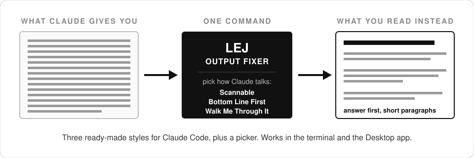

# LEJ Output Fixer

**Make Claude readable again.** Three ready-made output styles for Claude Code, plus a picker command. Works in the terminal and the Desktop app.




## Install it in under a minute

Paste this to your Claude (terminal or Desktop, doesn't matter):

```
Install the lej-output-fixer plugin for me:
1. Run: claude plugin marketplace add justfinethanku/LEJ-output-fixer
2. Run: claude plugin install lej-output-fixer@lej
Then start a fresh session, run /lej-output-fixer:style, and help me pick a style.
```

That's the whole install. Claude runs the two commands, you pick a style from a menu, done.

Rather type it yourself? Same two commands:

```bash
claude plugin marketplace add justfinethanku/LEJ-output-fixer
```

```bash
claude plugin install lej-output-fixer@lej
```

## Why this exists

You ask Claude a question. You get back a wall of text... dense, jargon-packed, zero paragraph breaks. You read it twice and you're still not sure what the actual answer was.


Here's the thing: Claude Code already ships with a fix. It's called an output style, and it swaps out the part of Claude's instructions that controls tone and formatting. Not a suggestion layered on top... a real replacement, built into the product.

But the menu for it lives three levels deep in the terminal, and the Desktop app doesn't show it at all. A feature nobody can find is a feature nobody uses.

So this plugin puts a door on it. Three styles that fix the actual complaints, and one command that lets you switch, turn them off, or build your own.

## The three styles


**Scannable**: Answer first, short paragraphs, 8th-grade reading level, jargon spelled out. For when you're smart but busy and Claude keeps handing you homework.

**Bottom Line First**: Executive brief mode. The verdict up top, then only the details that would change a decision. Numbers over adjectives.

**Walk Me Through It**: Claude does the work at full quality but narrates it: says what it's about to do, defines every term, explains what happened in plain cause-and-effect. For when the territory is new to you.

All three keep Claude Code's coding instructions fully intact. They change how Claude talks, never how well it codes.

## Using it

Run:

```
/lej-output-fixer:style
```

You get a menu: the three styles above, any styles you've made yourself, **No output style** to go back to stock Claude, and **Create new preset**.

Pick one and it's active everywhere Claude Code runs for you. Switching and un-switching is the same command again.

## Build your own style

Pick **Create new preset** from the menu and Claude interviews you: what should it be called, how formal, how long-winded, what formatting you want, what habits drive you nuts. It writes the style file to your own `~/.claude/output-styles/` folder and offers to turn it on.

Your custom styles belong to you, not to this plugin. Updates and uninstalls never touch them.

## Good to know

- **Nothing activates on install.** The plugin never touches your settings until you pick a style from the menu yourself.
- **One setting, nothing else.** Picking a style writes one field (`outputStyle`) to your Claude settings. Turning styles off removes that field. That's the entire footprint.
- **New sessions pick up changes.** If a style switch doesn't kick in mid-session, start a fresh session and it's there.
- **Uninstall**: `claude plugin uninstall lej-output-fixer` puts everything back the way it was. Custom styles you created stay yours.

## Credit

Built by [Jonathan Edwards](https://github.com/justfinethanku). The styles exist because good answers you can't read aren't good answers.

MIT licensed. Take it, fork it, make your own presets.
